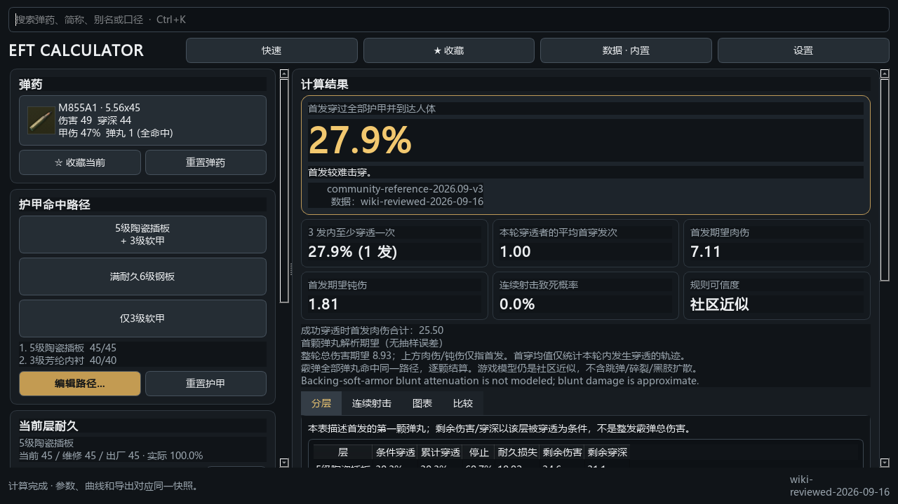
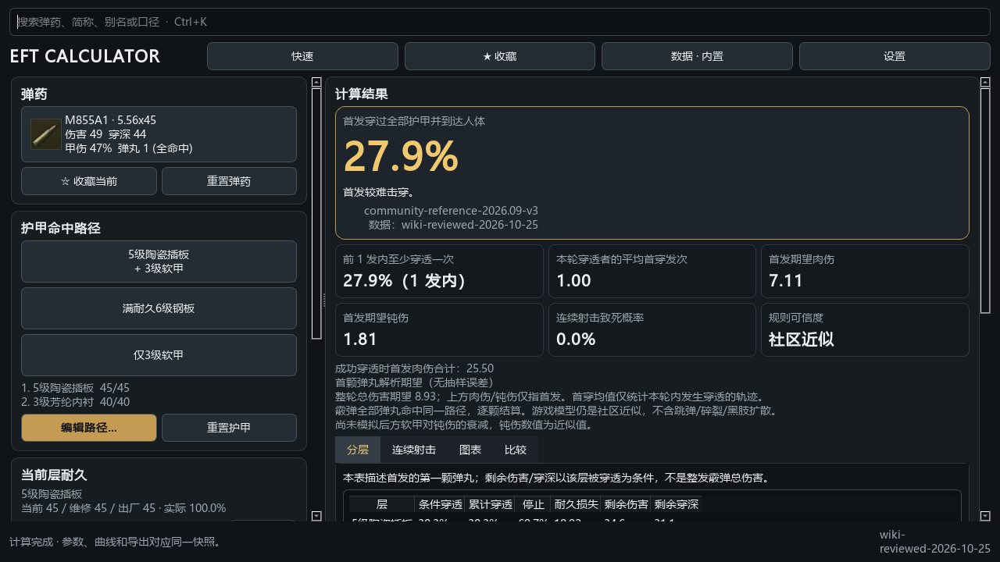
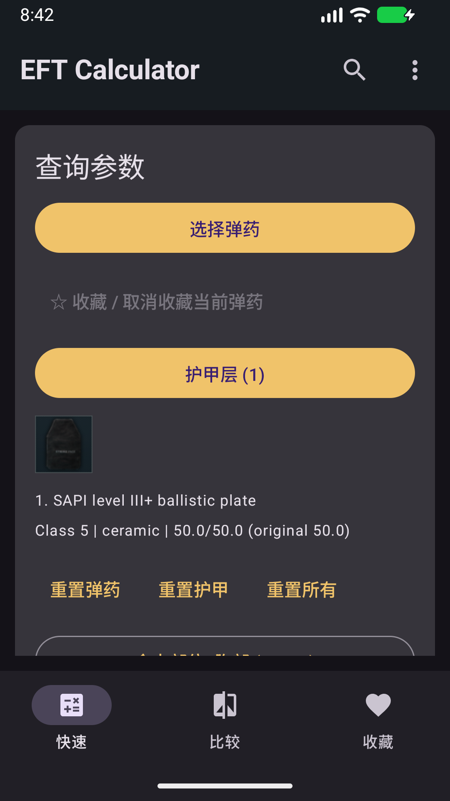
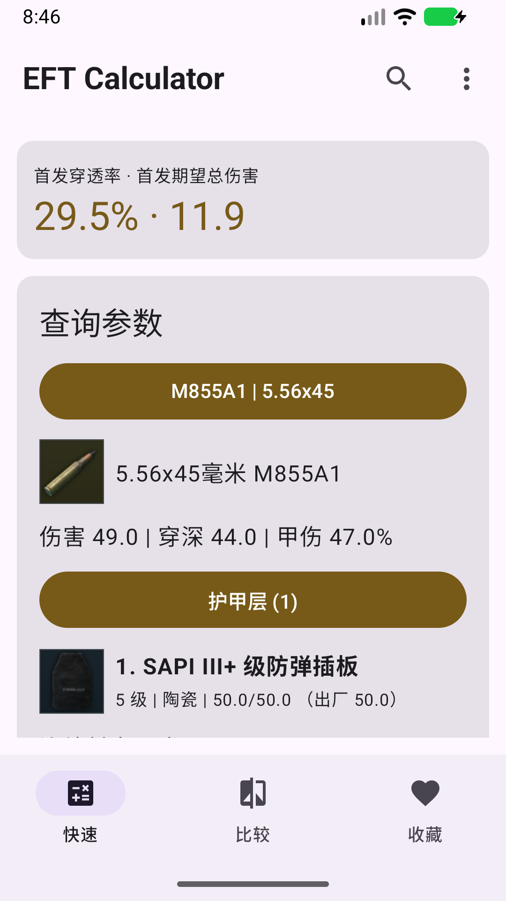
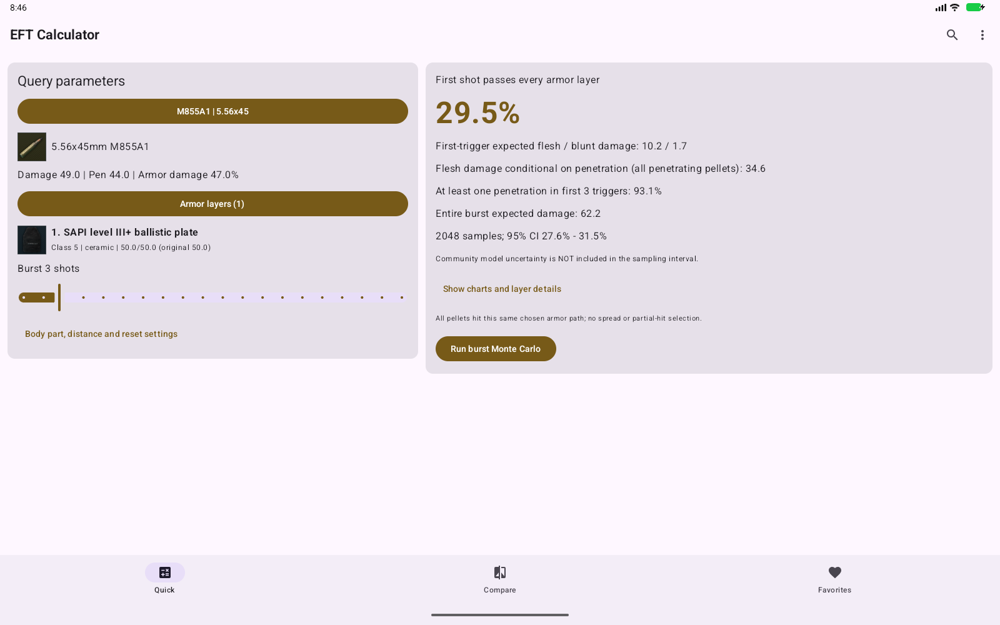

# EFT Calculator 全项目审计 — 2026-10-25

## 结论与边界

本次以 GitHub `main` 的 v2.2.2 / `2e332e3541dd1818cdc74e2710c1bce4beb7f5ca`
为唯一主要基线；候选版本为 2.2.3。计算公式没有为了重构而重写，原有六组共享向量的数值期望保持不变。
修复输入/持久化/数据安全/界面问题，新增独立数值与真实成品验收。

**不是“已还原当前服务器”。** 公开物品事实、社区方程、实验假设分别记录。
三项来源冲突尚未解决；本轮不自动创建正式 Release、不覆盖旧 Tag。
最终提交和远端 Actions 验收见本目录的 `AUDIT_DELIVERY_2026-10-25.md`（远端检查完成后记录）。

## 1. 基线、历史与工作目录

- `D:\CODE\EFT` 不存在。初始 `D:\CODE\EFT-Armor-Calculator` 是无 Git 元数据的旧 Android 工程，完整保留。
- 正式仓库克隆于 `D:\CODE\EFT-Armor-Calculator\remote-main`，直接维护 `main`，没有新建工作分支。
- 已执行 `git fetch --all --tags --prune`，起始 main、v2.2.2 Tag、最新 Release 指向同一 SHA。
- 四个历史 PR 均已合并；剩余远端分支没有未合并到 main 的提交。没有删除分支、历史或用户数据。
- 起始 Actions：Regression [35262430705](https://github.com/RICHARDwuxiaofei/eft-calculator/actions/runs/35262430705)、
  双端构建 [35262430971](https://github.com/RICHARDwuxiaofei/eft-calculator/actions/runs/35262430971) 均成功。
- 原测试基线 117 项通过；本轮扩展后结果和实际产物哈希留存于审计证据目录。

## 2. 实际功能与参数清单

| 范围 | Windows | Android / 共享核心 |
|---|---|---|
| 弹药选择 | 中英名、缩写、别名、口径、收藏；自定义弹药 | 中英名、别名、口径、收藏；相同离线目录 |
| 护甲编辑 | 插板预设、载具/方向选择、手动层、启用/排序/删除、保存预设 | 插板目录、手动层、启用/排序/删除；不自动叠前后板 |
| 护甲输入 | 1—6 级、8 材料、当前/维修上限/出厂耐久、层类型、钝伤透过率 | 同样的核心参数；当前耐久不超过维修上限，维修上限不得为零 |
| 射击条件 | 胸/头/腹、距离 0—1000 m、1—100 发、抽样次数 | 手机 1—20 发、0—1000 m；核心最多 100 发、12 层、64 弹丸 |
| 模式 | 单弹丸解析、依赖历史快速抽样、显式 Monte Carlo；实验规则集 | 同一 Python 核心，预览/完整模拟；距离假设默认关闭 |
| 结果 | 首发穿透、肉伤/钝伤、条件肉伤、首次/累计穿透、整轮伤害、致死、分层表/图、弹药计算对比 | 相同核心定义；Android“比较”为弹药属性表，明确标注并非穿透概率比较 |
| 图表 | 逐发概率、耐久时序、单层耐久扫描，范围保护 | 逐发概率、耐久曲线，默认折叠；概率固定 0—100% |
| 导出与保存 | JSON/CSV、收藏、自定义预设、当前输入、语言/窗口状态 | Room 收藏/数据；DataStore 当前输入；结果不持久化，恢复后重新计算 |
| 网络与离线 | 当前 API、带哈希/时间的快照、备份/失败保留 | 当前 API 事务合并、离线打包；同步失败不回退历史 Tracker |

弹药伤害是**每颗弹丸**的伤害；穿深无单位；甲伤是 0—100 的百分比；跳弹/破片元数据是 0—1 概率。
目前初速、跳弹和破片元数据不驱动默认伤害计算；距离关闭时更改距离不改变结果是预期行为，不是假控件。
出厂耐久是抗性分母；维修上限只约束当前耐久。`is_hard_armor` 是元数据，具体插板钝伤系数由层类型决定。
载具与槽位预设不是当前游戏所有兼容/覆盖规则的验证器；手动输入的路径由用户负责选择实际命中方向。

## 3. 发现与修复

| 严重度 | 可复现输入/状态 | 审计发现 | 修复与验证 |
|---|---|---|---|
| 高 | SQLite 文件写入非数据库字节后启动 | 桌面可能启动失败；重建可能丢失原文件 | 完整原文件及 WAL/SHM 保全再建立离线库；字节相等测试及真实 EXE corrupt 场景 |
| 高 | 某弹药 JSON 行 `damage="invalid-user-value"`，保留收藏 | 单条坏行使整库读取失败 | 整库迁移前备份、坏行隔离表保存原载荷/原因，已知目录行恢复，收藏保留 |
| 高 | 旧数据库初速为 0 等遗留可选字段 | 旧版本启动兼容须证明而非猜测 | 先一致性备份再做非破坏修复；旧库 EXE 启动及 Room 1→2 真机迁移测试 |
| 高 | Windows 构建 PATH 含第三方 Poppler 的 `icuuc.dll` | PyInstaller 错收不兼容 ICU；GUI 包表面超时，诊断包显示 QtCore 导入失败 | 构建仅使用本 Python 和 Windows 搜索目录；重建后三类 EXE 场景均退出 0 并渲染 |
| 高 | 较旧/哈希损坏快照，或在线覆盖 `manual-override` | 有回滚新数据/覆盖人工编辑风险 | 拒绝倒退时间和哈希不符；保护人工覆盖；损坏主缓存不覆盖有效备份；新增回归 |
| 中 | JSON 仅指定非零距离，省略衰减开关 | API 默认开、前端默认关，跨调用语义不同 | 模型及反序列化默认均关闭；距离默认一致性测试 |
| 中 | `enabled="false"`、布尔充当数值、NaN/极大值、异常 compare 输入 | 弱类型或极端值导致错误语义/异常 | 严格类型、有限范围、核心工作量上限、compare 结构化错误；性质与边界回归 |
| 中 | `M855A1 5.56`、API 标识口径、未列入快捷表的口径 | 搜索词序/口径筛选不完整 | 分词无序匹配；动态完整口径列表；Android 同步标识标准化；保留量规别名 |
| 中 | 修改护甲/发数后关闭并重开 | 以前不完整恢复实际输入 | 两端保存输入并重算，不恢复旧结果；自定义输入保留，已知弹药按现目录解析 |
| 中 | 英文、腹部、仅 1 发、首发与整轮混用 | 动态提示中英混杂，前三发标签可能超出计算范围 | 本轮统一动态术语，`min(3,N)` 标签，腹部明确未建模，默认首屏结论卡 |
| 中 | 离屏环境字体枚举失败、原测试共享 Qt 用户设置 | 真实字体未加载时文本变方框且尺寸虚大；测试依赖机器历史状态 | 显式注册真实字体，窗口构造与正式入口一致；测试显式 INI 路径，每例隔离 |
| 低 | FORMULA_LIMITATIONS 称 Logistic；架构称 NumPy 引擎 | 文档与运行代码不符 | 更新为分段 v3 方程/硬边界、实际 `random.Random` 引擎与当前模块结构 |

Android 新增损坏回调：在平台默认处理可能删除文件前，保存数据库、WAL/SHM/journal 字节；
若备份失败则不继续默认删除。专用模拟器验证了原始字节至少有一份完整保留。
保全不代表可恢复所有已经物理损坏的记录；应用显示离线目录不代表收藏已从坏库重建。

## 4. 数据溯源与冲突

抓取日期为上海时间 2026-10-25（证据 UTC 时间多数为 2026-10-24 晚间）。
Wiki 更新日志报告游戏 1.2.5.0.48146 / 2026-10-20；官方网站 403，未独立确认服务器当前版本。
Wiki HTML 403，但公开 MediaWiki API 可读；旧中文目录 404；tarkov.dev GraphQL 422。
没有把接口失败当作“数据已更新”，也没有用旧 Tracker 数值覆盖较新快照。

覆盖：184 弹药 + 38 插板 = 222 个现有物品身份，全部由各页内嵌 `node` 精确匹配。
Wiki 汇总表 1,072 项字段比对；作者维护图表 911 项；逐物品页 812 项观察，未解析值保留原文。
这三组检查有重叠，**不能相加当作独立物品数或全部字段成功率**。
图表 175 个破片字段在目录缺失，当前引擎不模拟破片，本轮不凭猜测补入。

实际应用 401 个字段更新：222 个失效 Wiki 链接替换为已核对物品页，179 个跳弹元数据补齐。
伤害、穿深、甲伤、初速和插板基础参数没有无依据重写。目录标记为 `wiki-reviewed-2026-10-25`，
表示本次审阅日期，不是每个数值都在该游戏补丁更新的宣称。

| 物品 | 字段 | 保留值 | 冲突来源 | 为什么未直接改 |
|---|---|---:|---|---|
| .300 Whisper / `6196365d58ef8c428c287da1` | 甲伤 % | 18 | Wiki 汇总 19；单物品页 18 | 同站表格与逐页不一致，当前 API 不可用 |
| 7.62x54 R SP BT / `64b8f7b5389d7ffd620ccba2` | 初速 m/s | 703 | Wiki 汇总/作者图表 706；单物品页 703 | 保留已有码，明确记录分歧；默认伤害不使用初速 |
| 20/70 Poleva-3 / `5d6e6a53a4b9361bd473feec` | 每弹丸伤害 | 120 | Wiki 单页 140（2025-11-18）；汇总/作者图表 120 | 单页较旧且与两个表冲突，不悄悄改成 140 |

5.8×42 四种全部比对，均为单弹丸：

| 弹药 | 伤害 | 穿深 | 甲伤 % | 初速 m/s |
|---|---:|---:|---:|---:|
| DBX95 | 57 | 33 | 40 | 910 |
| DBP191 | 53 | 39 | 43 | 840 |
| DVX12 | 48 | 47 | 54 | 850 |
| DVC12 | 46 | 52 | 60 | 872 |

图表多出的 Ball 11 Long Range、Tungsten Carbide AP 已通过 Wiki 单页确认仅限 Arena，
其余四项为榴弹/固定武器条目，均不盲目加入手持枪弹目录。现有 184/38 数量因此保留，
不是一开始假定数量不变。头盔、整件防弹衣和软甲的完整当前物品库仍未建立；不能声称全部游戏装备都已收录。

机器报告：[比对清单](audits/2026-10-25/inventory.json)、[单页与修订号](audits/2026-10-25/item-pages.json)、
[实际数据差异](audits/2026-10-25/applied-data-diff.json)、[抓取清单](audits/2026-10-25/sources.json)。
公开原始响应压缩包、各证据 SHA256 同目录保存；失败页面只保留状态/哈希，不保存挑战令牌。

主要来源：[Wiki 弹道](https://escapefromtarkov.fandom.com/wiki/Ballistics)、
[插板](https://escapefromtarkov.fandom.com/wiki/Armor_plates)、
[更新日志](https://escapefromtarkov.fandom.com/wiki/Changelog)、
[作者维护图表](https://eft-ammo.vercel.app/)、[tarkov.dev API](https://tarkov.dev/api/)。

## 5. 独立数值实验

`tools/independent_reference.py` 用 50 位 Decimal 与独立事件树推导期望值，生成期望过程中不调用生产核心。
参考方程的外部依据与未证实部分见 [公式限制](FORMULA_LIMITATIONS.md)，不是游戏内“真值”。

- 92 组：1—6 级 × 四个耐久比 × 低/中/高穿深，八材料、修复分母、四种 5.8×42、
  零耐久、多层三发、霰弹八弹丸、头/腹血量及距离开关。
- 600 组确定性 Hypothesis 性质案例：概率范围、穿深单调、破损层必通过、磨损有界。
- 5 个依赖历史案例各 100,000 次固定种子抽样；其余为解析比较。
- 最大解析穿透概率绝对误差 `1.6653345369377348e-15`。
- 最大抽样穿透概率误差 `0.0012284638718347`，即约 **0.123 个百分点**；
  最大首发肉伤误差约 .0513、钝伤 .00421、整轮伤害 .0383。
- 所选复杂案例独立参考概率均落在该固定种子运行的 95% Wilson 区间内。
  例如双层三发：参考 .8981215361、抽样 .89935，区间 [.8974698879,.9011994316]。
- Windows Python 与 Android 内嵌 Python 对原有 6 向量和新增 92 向量均作比较。
  该一致性只适用于相同完整参数、相同规则集和种子，不以两端默认页面的不同护甲结果互相作证。

详情：[数值误差/区间](audits/2026-10-25/numerical.json)、
[独立输入期望向量](../tests/fixtures/independent_cases_2026_10_25.json)。没有修改错误算法的预期值来求通过。

## 6. 图片完整性与准确性

222/222 个本地文件解码、尺寸、非空白、Item ID、SHA256 检查通过；
222/222 个精确 ID 远端 URL 重新获取成功，内容哈希全部与本地相同，没有替换成别的弹种。
有 12 组重复字节，源站本身也为对应不同 ID 返回这些相同图标；重复不自动等于错配。
五张物品联系表逐张视觉检查，未见空白、损坏或明显跨物品类别错配；
相似弹头的视觉检查不能证明内部弹芯/涂装真实准确，仍以来源和 ID 对应为证据边界。

Windows 包、Android debug 和 release 编译包均检查同一 222 图片与完整目录字节一致；
详情 [打包资产检查](audits/2026-10-25/packaging.json)、[线上图片核对](audits/2026-10-25/online-images.json)。
未修改游戏原图的权属，也没有宣称所有游戏素材都是开源授权。
新增在线条目缺图时显示问号；完整新图片的离线收录仍需精确 ID 下载、清单哈希、视觉复核和双端构建。

## 7. UI 与真实截图验收

保留现有桌面布局与 Android Material 3，不做与正确性无关的大规模框架替换。
改进：完整动态口径、无序搜索、中文动态术语、层顺序提示、正确概率口径、默认首屏摘要、
专业参数/图表按需展开、浅色状态栏对比度、真实图标、输入恢复。

桌面实际离屏渲染：1280×720、1920×1080、2560×1440，加 390×844、360×640 和护甲编辑器。
Android 为专用 API 36.1 x86_64 无窗口模拟器；中英双语分别检查竖屏 1080×1920、
横屏 1920×1080、窄屏 720×1280、宽屏 1600×1000；不是仅检查进程。
ADB 只连接本次专用 emulator-5580；未操作用户的游戏窗口或个人模拟器。

桌面修改前（实际基线代码）：

桌面修改后：

Android 修改前/后：

Android 宽屏：

截图来自真实控件渲染，不是设计稿；不同默认选项/窗口位置的截图不用于数值差异判定。
桌面当前为深色设计，未新增完整浅色主题；Android 随系统深浅色，另在 `android-dark/` 留存深色双语四布局截图。
未完成所有 OEM/字体缩放/真实 ARM 手机的视觉验收，不能用模拟器替代这些结论。

## 8. 构建、回归、签名与发布

本地 Ruff 通过，pytest **230 项通过**，Android JVM **4 项通过**，专用模拟器 instrumentation **5 项通过**。
本地验收还包括数据库坏行/坏文件/旧库、真实 Windows EXE 三场景、
Android JVM、Room 迁移/坏文件、共享 Python 数值、Compose 重建，以及两种 APK 构建。
测试数量和运行证据保留在本目录 XML / instrumentation.txt / results.json，最终远端状态见交付记录。
Windows 与模拟器全程离屏/无窗口，临时用户目录与设置隔离，不以启动成功替代功能检查。

本机 Android debug APK 使用开发签名；release 构建为**未签名编译产物，不可当作可安装正式包**。
Windows 候选包没有 Authenticode 签名。哈希是完整性标识，不替代发行者身份认证。
现有 CI 会明确区分生产签名与 debug-signed 交付，不再在 push main 后自动发布正式版；
发布需显式开启且全部构建/运行依赖成功，既有 Release/Tag 不可被重写。

## 9. 剩余风险与正式发布门槛

1. 三项数值冲突需当前可信 API 或新实测/维护者修订进一步解决，尤其甲伤与伤害冲突可能影响结果。
2. 公开完整曲线、磨损/穿后/钝伤的当前补丁精确性未实弹验证，抽样置信区间不包含这种误差。
3. 真实兼容槽位、头盔/整甲完整目录、全部防护区域与修理机制并未完整建模。
4. 当前 API 未提供可信逐物品更新时间时，抓取时间不能证明服务端没有返回旧数值；禁止历史源静默兜底不等于能认证服务端新鲜度。
5. 桌面纯浅色主题、全部无障碍字号、真实 ARM/OEM 设备与游戏内对照尚未验收。
6. 本轮先交付已验证代码/证据，不强行正式发布；保留 v2.2.2 旧 Release 不动。

复现命令与证据工具均在 `tools/audit_*.py`、`independent_reference.py`、
`verify_packaged_windows.py`、`verify_android_runtime.py`、`package_audit_evidence.py`。
网络抓取、独立数值推导与打包验收是不同步骤；不要因离线重复运行失败就用旧结果伪装新抓取。
